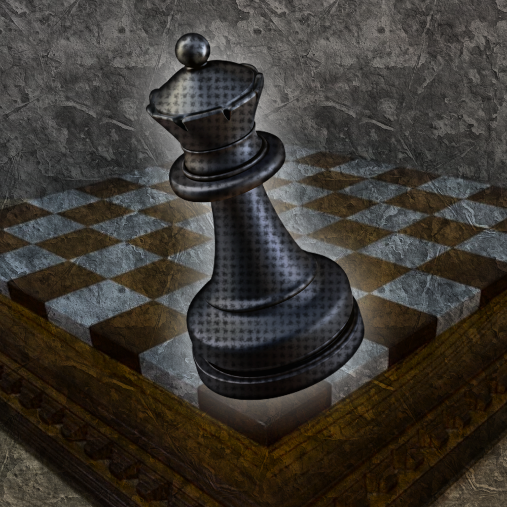

<h1 align="center">Glass Bishop </h1>
<h2 align="center">The Glass Cannon of Chess Engines</h2>
<p align="center">A positional evaluation engine for chess</p>


<div align="center">

[](https://forthebadge.com)
[](https://forthebadge.com)

</div>

<hr/>

## What is Glass Bishop?

Glass Bishop rates how **stupid** a position is. It reads a user's chess position from JSON, constructs a board, analyzes White's material and threats, searches for checkmate in one when White is to move, and reports a 0–100 Stupidity Score and its Stupidity Rating. It also examines every legal move for the side to move and recommends the move whose resulting position has the lowest Stupidity Score. A higher score means a more "stupid" position.

The engine is a one-ply move selector, not a full game-playing engine: it scores each legal next move but does not search a multi-move game tree. Scores are always from White's perspective, as specified by the scoring system.

## What happens when it runs?

For `java -jar ... position.json`, the program proceeds through these steps:

1. **Read and validate the input.** `PositionJsonReader` parses the JSON, translates piece names and algebraic squares into model objects, and checks required fields, unique occupied squares, king counts, pawn placement, and any supplied special-move state.
2. **Build the position.** `Board` stores an 8-by-8 arrangement plus side-to-move, castling rights, and the en-passant target. Applying a move creates a new board rather than modifying the original.
3. **Analyze the current position.** `PositionAnalyzer` totals White's material, totals the values of White's pieces attacked by Black, and checks for a legal White checkmate-in-one if White is to move.
4. **Evaluate every legal next move.** `MoveSelector` gets all legal moves for the side to move, applies each independently to a resulting board, and scores that board with the same `StupidityScorer`. It keeps the move with the lowest resulting score. If several moves tie, it reports the first one in move-generator order.
5. **Print the result.** The CLI prints the ASCII-art logo, a text board of the current position, its evaluation, the number of legal moves evaluated, and the selected move with its resulting score and rating.

## Stupidity Score

The existing 0–100 scale and rating bands are preserved. The score uses three components:

### 1. White material missing

Piece values are pawn = 1, knight = 3, bishop = 3, rook = 5, queen = 9. A king is not counted as material. A complete standard White army is worth 39 points: eight pawns (8), two knights (6), two bishops (6), two rooks (10), and a queen (9).

If White has less than 39 material points, the missing amount contributes proportionally up to 45 score points. Material above 39 is treated as no missing material; it cannot reduce the score below zero.

### 2. Attacked White pieces

Every White piece whose square is attacked by at least one Black piece contributes its value once to the attacked-material total. Multiple attackers do not count the same White piece multiple times. For this component only, a king under attack is assigned a value of 9; this does not add the king to White's material total. Attacked material is capped at 39 for scoring, and contributes proportionally up to 45 score points.

This is a threat indicator, not an exchange or safety analysis: the engine does not consider whether the attacked piece is defended, whether capturing it would be legal, or whether the attacker is itself vulnerable.

### 3. White checkmate in one

When White is to move, the engine looks at each legal White move. If any move leaves Black in check with no legal response, the position has a White mate-in-one and receives a 10-point bonus. If it is Black's turn, this feature is false and no bonus is applied.

### Combined formula and bounds

`missingMaterial = min(39, max(0, 39 - whiteMaterial))`

`exposedMaterial = min(39, attackedWhiteMaterial)`

`score = clamp(round(45 * missingMaterial / 39 + 45 * exposedMaterial / 39 + (whiteCanMateInOne ? 10 : 0)), 0, 100)`

The result is rounded to the nearest integer, then clamped to 0–100. The mate-in-one bonus is part of the requested Glass Bishop scoring behavior.

For example, the starting-position demo has 39 White material points, no attacked White pieces, and no mate in one, so it scores 0. `white-piece-attacked.json` has 9 White material points and 9 attacked points: its score is `round(45 * 30/39 + 45 * 9/39) = 45`. The mate-in-one demo has 9 White material points, no attacked White pieces, and a mate-in-one bonus, giving `round(45 * 30/39 + 10) = 45`.

| Stupidity Rating          | Stupidity Score |
|---------------------------|-----------------|
| RS - Reverse Stupid       | 0–10            |
| SR - Standard Rating      | 11–19           |
| SS - Slightly Stupid      | 20–29           |
| MS - Moderately Stupid    | 30–39           |
| PB - Probabile Blunder    | 40–49           |
| BS - Blunderous Stupidity | 50–59           |
| LaB - Likely a Blunder    | 60–69           |
| LI - Lethal Idiocy        | 70–79           |
| WB - Walnut Brain         | 80–85           |
| BFC - Banned From Chess   | 86–95           |
| ZE - Zero Elo             | 96–100          |

## Position JSON format

Create a UTF-8 JSON file containing the position to analyze. Coordinates use standard algebraic square names: files `a`–`h`, ranks `1`–`8`, with White's home rank numbered 1. Piece colors and types are case-insensitive; the examples use uppercase. Each piece object has three required string fields:

| Field | Allowed values / meaning |
|---|---|
| `color` | `WHITE` or `BLACK` |
| `type` | `PAWN`, `KNIGHT`, `BISHOP`, `ROOK`, `QUEEN`, or `KING` |
| `square` | One square from `a1` through `h8` |

The top-level `sideToMove` field is required and must be `WHITE` or `BLACK`. Exactly one king of each color must be present. Squares must be unique, and pawns cannot be placed on ranks 1 or 8. This validates the board's structure and special-move metadata; it does not prove that the position could have arisen from a legal game history.

`castlingRights` and `enPassantTarget` are optional. If omitted or empty/null, the engine assumes there are no corresponding rights. Include them only when they genuinely remain available in the position.

```json
{
  "sideToMove": "WHITE",
  "pieces": [
    { "color": "WHITE", "type": "KING", "square": "e1" },
    { "color": "WHITE", "type": "QUEEN", "square": "d1" },
    { "color": "WHITE", "type": "PAWN", "square": "e2" },
    { "color": "BLACK", "type": "KING", "square": "e8" },
    { "color": "BLACK", "type": "ROOK", "square": "a8" }
  ],
  "castlingRights": [],
  "enPassantTarget": null
}
```

Valid `castlingRights` entries are `WHITE_KINGSIDE`, `WHITE_QUEENSIDE`, `BLACK_KINGSIDE`, and `BLACK_QUEENSIDE`. Each supplied right must have the corresponding king and rook on their original squares (`e1` and `h1`/`a1` for White; `e8` and `h8`/`a8` for Black). The move generator also checks that the squares between them are empty and that the king does not castle out of, through, or into check.

`enPassantTarget` is either `null` or the empty square passed over by the immediately preceding two-square pawn move. For example, after White moves a pawn from `e2` to `e4`, the target is `e3` and Black is to move. The target's rank must match the side to move; the just-moved enemy pawn must be behind it, and its original square must now be empty.

### JSON examples

The repository includes three ready-to-run positions in `examples/`:

| File | Demonstrates |
|---|---|
| `starting-position.json` | The standard initial board and all four castling rights |
| `white-piece-attacked.json` | A White queen exposed to a Black rook |
| `white-mate-in-one.json` | A White queen and king position with a legal checkmate in one |

Use the starting position JSON as a template. For custom positions, edit the pieces and update the side to move and special-move fields to match the board.

## Chess rules implemented

### Attack detection

`AttackDetector` checks attacks against a target square by:

- Looking at the two diagonally forward source squares for pawns, in the attacker's direction (pawns attack diagonally even when the target square is empty).
- Checking the eight knight offsets and the adjacent king squares.
- Scanning each orthogonal ray for a rook or queen and each diagonal ray for a bishop or queen. A ray stops at its first occupied square, so pieces do not attack through blockers.

This detector is also used to determine check and to filter illegal moves. Attack maps are pseudo-legal threats: whether a piece could move to a square for attack purposes does not depend on whether moving it would expose its own king.

### Legal move generation

`MoveGenerator` first generates piece-specific candidate moves, then applies each candidate to a temporary board and rejects it if the moving side's king is still in check. This prevents leaving one's own king in check and handles pinned pieces through the same general test.

Implemented move rules include:

- Pawns move one square forward, may move two squares from their starting rank if both squares are clear, and capture one square diagonally.
- A pawn reaching the last rank can promote to a queen, rook, bishop, or knight; all four choices are checked as distinct candidate moves.
- Knights move in L-shaped offsets; kings move one square; bishops, rooks, and queens slide along their legal rays until blocked.
- Capturing the opposing king is never generated as a move. Checkmate instead means that king is in check and has no legal response.
- En passant removes the captured pawn from the board before checking whether the capturing side's king remains safe.
- Castling requires a matching right, the correct king and rook on their home squares, empty intervening squares, and unattacked transit/destination squares. Applying castling moves both king and rook and removes the king's castling rights.
- Moving a king or moving/capturing a rook on its original corner removes the corresponding castling rights. A two-square pawn move sets the next en-passant target; any other move clears it.

### Checkmate and mate-in-one

`PositionAnalyzer.isCheckmate` tests the standard condition: the specified side's king is in check and that side has no legal moves. `whiteCanMateInOne` does not merely test whether a move gives check: it applies each legal White move, then requires Black to be in check and to have zero legal replies. This also naturally handles checkmate by promotion or castling where applicable.

## Build and run

The project uses Maven and Java 21. From the project root, build and run the shaded executable JAR:

```sh
mvn package
java -jar target/GlassBishop-0.1.jar path/to/position.json
```

Run without arguments or pass `help` to display the built-in ASCII-art help menu:

```sh
java -jar target/GlassBishop-0.1.jar
java -jar target/GlassBishop-0.1.jar help
```

Run a demo:

```sh
java -jar target/GlassBishop-0.1.jar examples/starting-position.json
java -jar target/GlassBishop-0.1.jar examples/white-piece-attacked.json
java -jar target/GlassBishop-0.1.jar examples/white-mate-in-one.json
```

The CLI accepts no arguments or the single argument `help` to print the help menu; otherwise, pass exactly one JSON file path. For a position, it prints an ASCII board (ranks 8 to 1 from top to bottom, files a to h from left to right). White pieces are uppercase (`P N B R Q K`), Black pieces are lowercase (`p n b r q k`), and `.` marks an empty square. It then prints the current position's White material, attacked White material, mate-in-one status, score, and rating. If legal moves exist, it also prints how many it evaluated and the recommended move in coordinate notation (for example `e2e4` or `a7a8q`), plus the resulting score and rating. If the side to move has no legal moves, it reports checkmate or stalemate instead. Invalid argument combinations, unreadable/invalid JSON, or invalid position metadata are reported rather than producing an evaluation.

The recommendation is the legal move with the lowest resulting Stupidity Score, not necessarily the strongest chess move. Each candidate is applied to an independent board state, and the unchanged scoring formula is used on that resulting position. When scores tie, the first move in the generator's order is returned.

Run the automated tests with:

```sh
mvn test
```

## Project structure

Each package has one responsibility:

| Package / class | Responsibility |
|---|---|
| `org.GlassBishop.Main` | Command-line entry point; loads a JSON path and prints the evaluation |
| `org.GlassBishop.io.PositionJsonReader` | Parses and validates a JSON position |
| `org.GlassBishop.model` | Chess domain types: immutable `Piece`, `Square`, `Move`, `Board`, colors, piece types, and castling rights |
| `org.GlassBishop.engine.AttackDetector` | Square attack and check detection |
| `org.GlassBishop.engine.MoveGenerator` | Candidate move generation and legal-move filtering |
| `org.GlassBishop.engine.PositionAnalyzer` | White material, attacked material, checkmate, and mate-in-one analysis |
| `org.GlassBishop.engine.MoveSelector` | Scores each legal successor position and chooses the lowest-scoring move |
| `org.GlassBishop.engine.MoveRecommendation` | Carries the selected move, its resulting score, and number of evaluated legal moves |
| `org.GlassBishop.scoring.StupidityScorer` | Applies the 0–100 scoring formula |
| `org.GlassBishop.scoring.StupidityRating` | Maps scores to the existing rating bands |
| `org.GlassBishop.scoring.ScoreResult` | Carries the score and reported component values |
| `org.GlassBishop.utility.PrintASCII` | Console artwork |
| `org.GlassBishop.utility.BoardPrinter` | Renders the position as a basic text board |
| `src/test/java` | JUnit tests for chess rules and JSON loading |

## Scope and limitations

- Evaluation reports White's material, attacked pieces, and mate in one; it does not evaluate Black's material, positional advantage, or initiative.
- Move selection examines one ply (each legal move and its resulting position). It does not search a deeper tactical tree or identify the objectively best chess move.
- The engine does not enforce repetition, the fifty-move rule, insufficient-material draws, move counters, or game history. The supplied board and special-move rights are treated as the complete position.
- The reader checks basic structural consistency, not every requirement for a historically reachable FIDE position.
- Because attacked material measures attacked squares rather than likely captures, it should be interpreted as a simple exposure signal, not as a full chess evaluation.

## Misc

[Logo Asset](https://www.vecteezy.com/png/45686418-black-queen-chess-piece-3d), [Badges](https://forthebadge.com), [Ascii Art](https://www.asciiart.eu/image-to-ascii)
